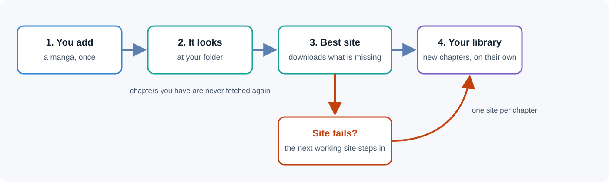
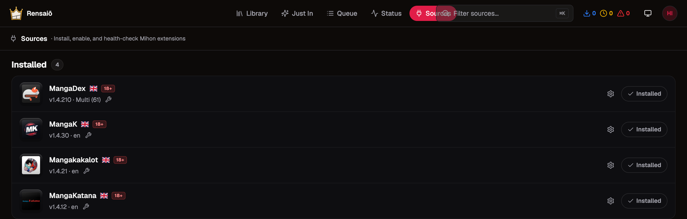
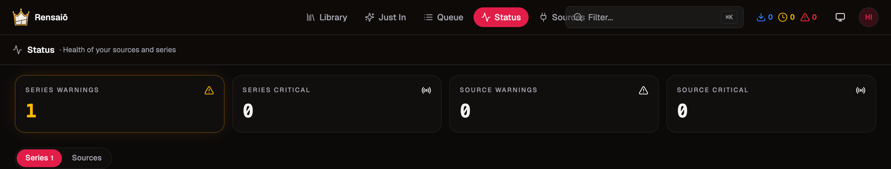

# Rensaiō for many sources

[](https://github.com/Hikki-dev/Rensaio/actions/workflows/image.yml)
[](LICENSE)
[](https://github.com/Hikki-dev/Rensaio/pkgs/container/rensaio)
[](https://github.com/maxpiva/Rensaio)

Follow a manga once. New chapters arrive by themselves, from whichever site works.

<p align="center"></p>

<p align="center"><sub>How a manga is added and kept up to date.</sub></p>

Most manga exist on several sites, and sites come and go. This is [Rensaiō](https://github.com/maxpiva/Rensaio), the manga downloader that carries on the archived [Kaizoku](https://github.com/oae/kaizoku), with the rough edges of many sources smoothed out. It does not fetch what you already have. It does not fetch one chapter from three places. When a site breaks, it moves on to the next one instead of waiting.

You do not need to know how manga sources work. Add a series, and it looks after the rest.

## On this page

* [What is different](#what-is-different): the four fixes, side by side with the original
* [How a chapter travels](#how-a-chapter-travels): from adding a series to a new chapter on your shelf
* [Run it](#run-it): one command, and how to move over from Kaizoku
* [A closer look](#a-closer-look): the screens that matter
* [Careful with real files](#careful-with-real-files)
* [Add a series from the command line](#add-a-series-from-the-command-line)
* [Help and more reading](#help-and-more-reading)
* [Credits and licence](#credits-and-licence)

## What is different

Everything Rensaiō does is still here. These five things changed.

| Situation | The original | This fork |
|---|---|---|
| You add a manga that is already in your folder | Lists every chapter and may fetch from chapter 1 | Reads your folder first. Chapters you have are never fetched again, and a gap in the middle is still filled |
| Several sites have the same chapter | Each one can download it | One site per chapter. The others skip it while it is queued or already there |
| A site fails on a chapter | Tries the same site again and again, for hours | Moves to the next working site that has it, straight away, and never goes back to one that failed |
| A site is down | Tries every title on it, tens of thousands of requests | Stops after 15 failures in a row and tries again on the next schedule |
| A chapter is missing in the middle of a series you follow | Stays missing for good | Filled in, a few at a time, from any site that has it. It never reaches back before your first chapter, and a chapter you removed on purpose is not brought back |

## How a chapter travels

1. You add a manga and pick the sites you like.
2. The app reads the folder it will use and finds the chapters already there. It understands names such as `Ch.230`, `Chapter 230`, `c230`, `Vol.23 Ch.229` and `Title 231.cbz`, and it never reads a volume number or a year as a chapter.
3. It marks those chapters as done and starts after the highest one.
4. The best site downloads only what is missing. The other sites see that the chapter is taken and leave it alone.
5. If a download fails, the chapter goes to the next healthy site that lists it. A site that already failed on it is not asked twice.
6. When a new chapter appears, the same thing happens again by itself. Any hole between the chapters you have is filled too, 25 at a time.

## Run it

```bash
docker run -d --name kaizoku --restart unless-stopped -p 9833:9833 \
  -e PUID=1000 -e PGID=1000 -e TZ=UTC \
  -v /path/to/config:/config \
  -v /path/to/manga:/series \
  ghcr.io/hikki-dev/rensaio:latest
```

Open `http://your-server:9833` and follow the short first-time setup.

Coming from Kaizoku 2.0 or Rensaiō? Stop the old container, copy your config folder somewhere safe, and start this image on the same two folders. Your series and settings are upgraded on the first start.

This fork is also what [media-server-setup](https://github.com/Hikki-dev/media-server-setup) installs for manga, next to Jellyfin and the rest of a home media server.

## A closer look

The Sources page shows every site you have installed, and the Status page tells you early when a site or a series needs attention.

<p align="center"></p>

<p align="center"></p>

## Careful with real files

The folder reading is built to be cautious, because it works on your real library.

* A number that looks like a year is ignored, so a stray `2023` never makes the app skip a whole series.
* Chapters such as `10.5` and `0` are kept as they are.
* If a folder has only a few chapters, the command line tool will not guess. It asks you whether to download everything or to continue after a chapter you choose.
* A site that is down, slow or blocked never stops the other sites from working.

The file name reader has its own small check: `cd tools/tests/ParserCheck && dotnet run`.

## Add a series from the command line

`tools/kaizoku_smart_add.py` searches every site, reads your folder and ranks the sites by how far they go and how recently they updated. The best one becomes the main source and the rest are kept as back-ups.

```bash
python3 tools/kaizoku_smart_add.py "Chainsaw Man" --library /path/to/manga          # shows the plan
python3 tools/kaizoku_smart_add.py "Chainsaw Man" --library /path/to/manga --apply  # adds it
```

It needs only Python 3.

## Help and more reading

* [FORK-NOTES.md](FORK-NOTES.md): every change in this fork and the files it touches
* [docs/Original guide.md](docs/Original%20guide.md): the full Rensaiō guide, for single sign-on, Unraid, Helm and the rest
* [Issues](https://github.com/Hikki-dev/Rensaio/issues): ask a question or report something that went wrong

## Credits and licence

All credit to maxpiva and the Rensaiō contributors, and to the Kaizoku authors before them. This fork changes only what is listed above. The licence is unchanged: GPL-3.0, see [LICENSE](LICENSE).

Manga sources are third-party sites. Use this only for content you have the right to download.
